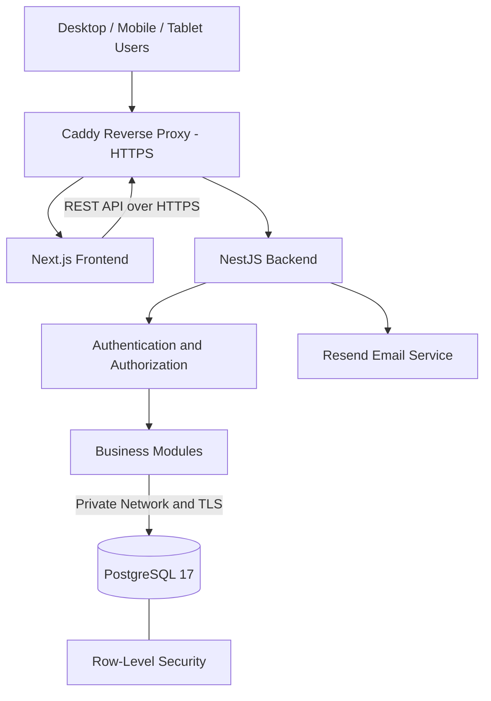
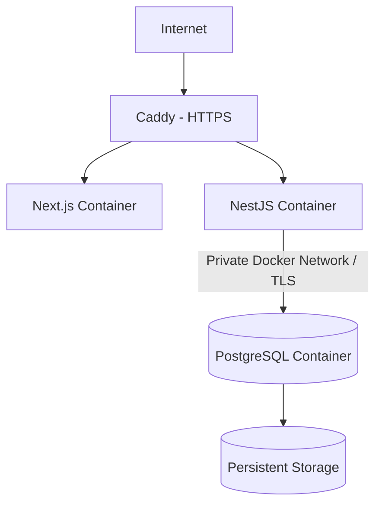

# PromiseFlow

### Multi-Tenant SaaS Workflow & Project Management Platform


## Live Demo

**[Explore PromiseFlow](https://promiseflow.duckdns.org)**

Click **Try Live Demo** to explore the platform without creating an account.

The interactive demo provides an isolated, read-only workspace populated with synthetic business data.

- No registration required
- No personal information required
- Isolated demo workspace
- Responsive interface
- English, German, Spanish and Arabic

## Overview

PromiseFlow is a full-stack, multi-tenant Software as a Service (SaaS) platform designed to help organizations manage projects, tasks, teams, workflows and business processes within a centralized workspace.

The project demonstrates end-to-end software engineering, including frontend development, backend architecture, relational database design, tenant isolation, authorization, automated testing, security hardening and production deployment.

## Key Features

| Module | Capabilities |
|---|---|
| Dashboard | Workspace overview and operational insights |
| Projects | Project organization and management |
| Tasks | Task tracking, priorities and status management |
| Teams | Team organization and collaboration |
| Workflows | Configurable workflow steps and transitions |
| Automations | Business process automation |
| Approvals | Structured approval processes |
| Notifications | Application notifications |
| Invitations | Organization membership invitations |
| Reports | Project and task analytics |
| Activity Log | Workspace activity tracking |
| Audit Log | Security and administrative event tracking |
| Settings | Workspace and account configuration |
| Roles & Permissions | Role-based authorization |
| API Keys & Webhooks | Integration capabilities |
| Subscriptions | Plans, features and usage limits |
| Live Demo | Secure, registration-free product exploration |

## Technology Stack

### Frontend

- Next.js
- React
- TypeScript
- Tailwind CSS
- next-intl
- Responsive Web Design
- Internationalization (i18n)
- Right-to-Left (RTL) language support

### Backend

- NestJS
- Node.js
- TypeScript
- REST API
- TypeORM
- JSON Web Tokens (JWT)
- Request validation
- Rate limiting

### Database

- PostgreSQL 17
- Row-Level Security (RLS)
- Relational database modeling
- Database migrations
- Transactions
- Database constraints
- Secure database functions

### Infrastructure & DevOps

- Docker
- Docker Compose
- Hetzner Cloud
- Ubuntu Server
- Caddy Reverse Proxy
- HTTPS and TLS
- Private Docker networks
- Git and GitHub
- Encrypted backups
- SHA-256 integrity verification

### Testing

- Jest
- Unit testing
- Integration testing
- End-to-end testing
- Database security testing
- Production API verification

## System Architecture

PromiseFlow follows a Modular Monolith architecture with clearly separated application responsibilities.



### Architectural Decisions

- Modular Monolith instead of premature microservice decomposition.
- Separation of frontend, backend and database infrastructure.
- Database-level tenant isolation combined with application-level authorization.
- Version-controlled database migrations.
- Containerized production services.
- Private database networking.
- Environment-specific configuration and production validation.

The architecture allows individual modules to be evaluated for future service extraction when justified by scalability, operational or business requirements.

## Multi-Tenant Architecture

PromiseFlow supports multiple organizations within a shared application infrastructure.

Each organization operates within its own workspace, with access controlled through organization memberships, roles and permissions.

Tenant isolation is enforced through:

- Organization-scoped business entities
- Membership validation
- Role-Based Access Control (RBAC)
- PostgreSQL Row-Level Security (RLS)
- Application-level authorization
- Database-level constraints and security policies

## Security

Security is implemented across the application, database and infrastructure layers.

### Authentication and Authorization

- JWT-based authentication
- Password hashing
- Email verification for new registrations
- Secure invitation acceptance
- Role-Based Access Control
- Organization membership validation
- Protected API endpoints

### Database Security

- PostgreSQL Row-Level Security
- Restricted application database roles
- Tenant-aware database access
- Secure database functions
- Transaction-based operations
- TLS certificate verification

### Infrastructure Security

- HTTPS encryption
- Restricted public network exposure
- Private database network
- Firewall configuration
- Trusted reverse proxy configuration
- Authentication endpoint rate limiting
- Production environment validation
- Encrypted backups

### Live Demo Security

The public demo is designed to allow safe product exploration.

- Dedicated demo identity
- Isolated demo organization
- Synthetic business data
- Read-only API access
- Restricted application routes
- Server-side write protection
- Expiring authentication tokens

## Internationalization

PromiseFlow supports four languages:

| Language | Locale | Direction |
|---|---|---|
| English | EN | LTR |
| German | DE | LTR |
| Spanish | ES | LTR |
| Arabic | AR | RTL |

The interface supports desktop, laptop, tablet and mobile screen sizes.

## Testing & Quality Assurance

The following results were recorded during the November 2026 release verification.

| Verification | Result |
|---|---|
| Backend automated tests | 155/155 passed |
| Database migrations | 44/44 applied |
| Demo seed verification | 11/11 passed |
| Production API security checks | 15/15 passed |
| Production rate limiting test | 6/6 passed |
| Frontend production build | Passed |
| Backend production build | Passed |
| Production dependency audit | 0 reported vulnerabilities |
| Encrypted backup integrity | Verified |

Production verification included authentication, authorized read access, restricted routes, blocked write operations and rate limiting.

These results represent the tested release and scenarios rather than a guarantee of complete security.

## Production Deployment

PromiseFlow is deployed on Hetzner Cloud using Docker containers.



The production deployment includes:

- Containerized frontend and backend
- Persistent PostgreSQL storage
- HTTPS reverse proxy
- Private database connectivity
- Production environment validation
- Database migration management
- Encrypted local and off-site backups

## Repository Structure

```text
PromiseFlow/
├── apps/
│   ├── api/          # NestJS backend
│   └── web/          # Next.js frontend
├── .gitignore
└── README.md
```

## Local Development

### Prerequisites

- Node.js 24
- npm
- PostgreSQL 17
- Git

### Clone the repository

```bash
git clone https://github.com/ahdpromise/PromiseFlow.git
cd PromiseFlow
```

### Install backend dependencies

```bash
cd apps/api
npm ci
```

### Install frontend dependencies

```bash
cd ../web
npm ci
```

### Environment Configuration

Local development requires a PostgreSQL database, application-specific environment variables and the appropriate database roles and permissions.

Configure the backend and frontend environments before starting the application.

Never commit real credentials, API keys, private certificates or production environment files.

### Start the backend

```bash
cd apps/api
npm run start:dev
```

### Start the frontend

```bash
cd apps/web
npm run dev
```

Default local application endpoints:

- Frontend: `http://localhost:3000`
- Backend: `http://localhost:3001`

### Run backend tests

```bash
cd apps/api
NODE_OPTIONS="--experimental-vm-modules" npm test -- --runInBand
```

Some integration tests require a dedicated, correctly configured test database.

## Current Release Status

- Live production deployment
- Public interactive demo
- Core SaaS functionality implemented
- Production security verification completed for the tested scenarios

Public registration and invitation email delivery are currently limited by the email provider's domain verification requirements.

## Future Roadmap

- Custom production domain
- Public transactional email delivery
- Legacy account email verification
- Expanded operational monitoring
- Disaster recovery improvements
- Microservices evaluation and selective service extraction
- AWS infrastructure evaluation and deployment

## Project Purpose

PromiseFlow is an independently developed software engineering portfolio project demonstrating practical experience in:

- Full-Stack Development
- Software Architecture
- SaaS Application Development
- Multi-Tenant Systems
- REST API Development
- Relational Database Engineering
- Application Security
- Automated Testing
- DevOps and Production Deployment

---

**PromiseFlow — From architecture and development to a live production deployment.**

[Explore the Live Demo](https://promiseflow.duckdns.org)
